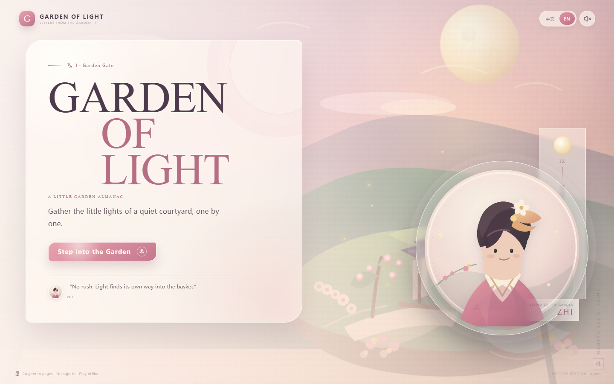
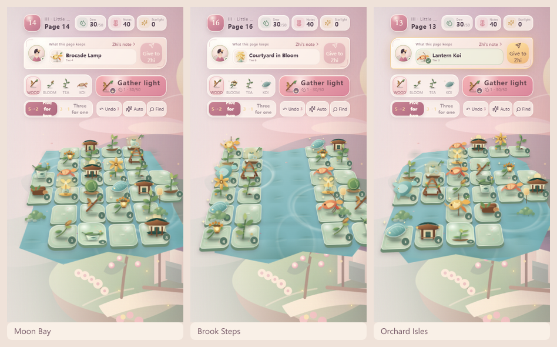
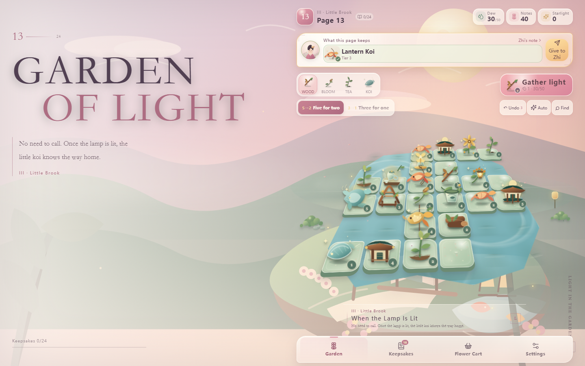
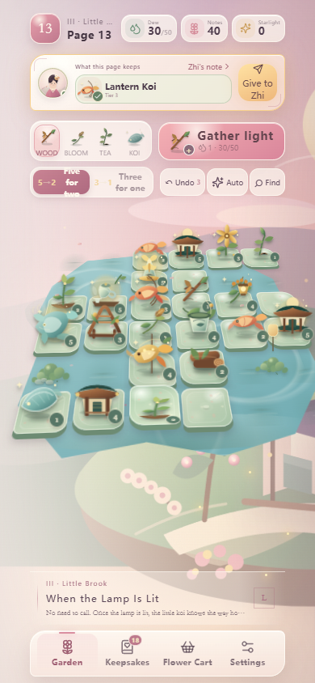
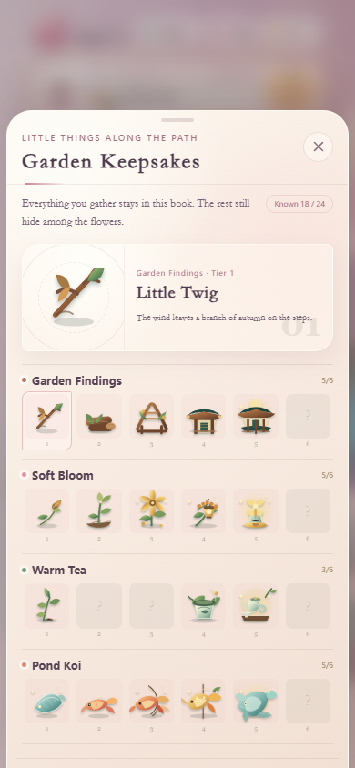

<div align="center">
  
  <h1>Garden of Little Lights</h1>
  <p><strong>A slow, cozy 2.5D garden merge journal.</strong></p>
  <p>English · <a href="./README.zh-CN.md">中文说明</a></p>

  [](https://github.com/ZhuangHT-1201/garden-of-little-lights/actions/workflows/ci.yml)
  [](./LICENSE)
  [](#platform-support)
  [](#privacy)
</div>

Garden of Little Lights is an original, open-source courtyard game about gathering
small objects, merging them into larger keepsakes, and slowly filling a handmade
almanac. It combines a low-angle 2.5D board with paper-cut scenery, six irregular
7×7 garden terraces, 24 chapters, bilingual UI, and a local-first save system.

No account, ads, analytics, or server connection is required during play.

**[Play in your browser](https://zhuanght-1201.github.io/garden-of-little-lights/)** · **[Download the latest release](https://github.com/ZhuangHT-1201/garden-of-little-lights/releases/latest)** · **[Report a bug](https://github.com/ZhuangHT-1201/garden-of-little-lights/issues/new)**

## A board that grows with the courtyard

The board is not a flat grid. Each terrace is tilted into the scene, its items
stand as paper sculptures with contact shadows, and the playable footprint changes
between full courtyards, moon bays, split brook terraces, flower crosses, orchard
islands, and moonlit courts.



## Features

- **24 handcrafted garden pages** across four illustrated chapters.
- **Two adjacency-based merge rules:** five touching items become two, or three become one.
- **Six irregular 7×7 board silhouettes** with chapter-specific terrain palettes.
- **Four collectible item families:** garden findings, soft blooms, warm tea, and pond koi.
- **Progression without pressure:** fog clearing, undo, auto-merge, hints, daily gifts, and a local shop.
- **A collectible almanac** with 24 discoverable item tiers and short lore entries.
- **Three visual moods:** Peach Dusk, Morning Haze, and Firefly Eve.
- **Complete English and Simplified Chinese interfaces.**
- **Responsive and installable** as a browser PWA, Windows desktop app, Android app, and iOS project.

## Gameplay

Tap a tile to select it, then tap a touching tile to move or merge. You can also
drag directly between tiles. Matching items must form a connected group using side
or corner adjacency before they can merge; diagonal contact counts. Clear mist by
spending dew, gather new objects, and deliver the items requested by the current
garden page.

| Action | Mouse / touch | Keyboard |
| --- | --- | --- |
| Select a tile | Tap or click | `Tab`, then `Enter` / `Space` |
| Move / merge | Tap a second tile, or drag | Select source, then target |
| Clear fog | Select the fog tile | Focus and activate |
| Switch merge rule | Use the `5→2` / `3→1` control | Focus and activate |

The five-to-two rule is usually the most efficient way to reach a high-tier goal
without wasting dew or board space.



<p align="center">
  
  
</p>

## Playing locally

### Requirements

- Node.js 22.12 or newer
- npm 10 or newer

```bash
npm install
npm run dev
```

Open the URL printed by Vite. For LAN testing, open the network URL on a phone
connected to the same Wi-Fi network.

To verify a production build:

```bash
npm run build
npm run preview
```

## Platform support

| Platform | How to run | Notes |
| --- | --- | --- |
| Browser | `npm run dev` or deploy `dist/` | Installable PWA; offline after first load |
| Windows | `npm run desktop:build` | Portable Electron executable |
| Android | `npm run android:build` | Requires JDK 21 and the Android SDK |
| iOS | `npm run ios:sync` | Open the Xcode workspace on macOS to sign and archive |

### Android signing

Copy `.env.android.example` to `.env.android`, then set your own keystore path,
passwords, and key alias. The real `.env.android` and keystore files are ignored
by Git.

```bash
npm run android:build
```

### Windows

```bash
npm run desktop:build
```

The portable executable is written to `releases/desktop/`.

### iOS

```bash
npm run ios:sync
```

Open `ios/App/App.xcworkspace` in Xcode on macOS to configure signing, archive,
and export the app.

## Tech stack

| Layer | Technology |
| --- | --- |
| UI | React 19 + TypeScript |
| Build | Vite 6 |
| Styling | Hand-authored CSS, CSS 3D transforms, and inline SVG artwork |
| Web app | `vite-plugin-pwa` service worker |
| Desktop | Electron + electron-builder |
| Mobile | Capacitor 7 for Android and iOS |
| Verification | TypeScript build and Playwright interaction checks |

## Project structure

```text
src/
  components/       UI, board rendering, item artwork, sheets
  game/             reducer, levels, i18n, audio, persistence
  styles.css        responsive interface and 2.5D scene styling
public/             icons, scenery, and install assets
desktop/            Electron host
android/            Capacitor Android project
ios/                Capacitor iOS project
scripts/            asset generation, packaging, screenshots, and UI checks
docs/screenshots/   English documentation screenshots
```

## Privacy

The game stores progress in browser `localStorage`. There is no account system,
remote sync, advertising SDK, or analytics in the current release. Desktop and
mobile builds serve the same local web application and do not require a backend.

## Contributing

Contributions, bug reports, accessibility feedback, and new translations are
welcome. Read [CONTRIBUTING.md](./CONTRIBUTING.md) before opening a pull request.

## Design direction

The project is an original implementation and uses original code and in-repo
artwork. Its spatial direction was developed from general research into
low-angle garden boards, tactile merge interactions, and resource planning for
adjacency-based merge games. No third-party characters, artwork, or trademarks
are included in this repository.

## License

Released under the [MIT License](./LICENSE).
