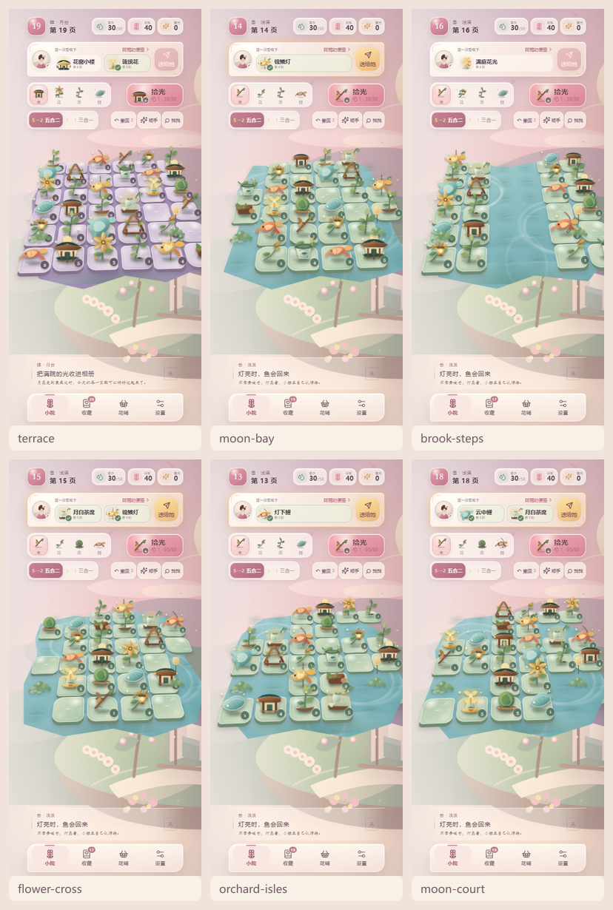

# 桂庭拾光

[English](./README.md) · 中文说明

一款柔和的开源 2.5D 庭院合成手账，包含 24 个关卡、四类小物、花雾解锁、收藏册、
花铺、三套院景，以及完整的中英双语切换。棋盘采用低角度斜俯视与站立剪纸小景，
并在整院、月湾、溪阶、花十字、果园双岛和月庭六种地块轮廓之间轮换。



## 特性

- 五合二与三合一两种合成规则。
- 24 个庭院关卡、四类物品、六种不规则棋盘。
- 花雾解锁、撤销、自动合成、提示、每日礼物与花铺。
- 本地收藏册、三套院景与完整双语界面。
- Web PWA、Windows、Android 与 iOS 多端支持。
- 无需登录、无广告，游戏进度保存在本地。

## 本地运行

需要 Node.js 22.12 或更高版本。

```bash
npm install
npm run dev
```

生产构建：

```bash
npm run build
npm run preview
```

## 打包

```bash
npm run desktop:build
npm run android:build
npm run ios:sync
```

Android 签名信息请参考 `.env.android.example`。不要提交真实密钥、密码或
`.env.android` 文件。iOS 的签名、归档与 IPA 导出需在 macOS 的 Xcode 中完成。

## 隐私

当前版本不包含账号系统、远程同步、广告 SDK 或分析服务，进度保存在浏览器
`localStorage` 中。

## 贡献与许可

贡献前请阅读 [CONTRIBUTING.md](./CONTRIBUTING.md)。项目使用
[MIT License](./LICENSE) 开源。
